### 我是高一物理教师，现在要你根据我所发四张图片做教学设计，要求如下：

1. 把最初始发给你的四张图片转为md文档，注意图片中有多部份的文字内容，特别不能遗漏我所发给你的手写部分的内容
2. 内容包括六部分内容：
   1. 总括 ；
   2. 第一部分 时刻和时间间隔（包括 时刻、时间间隔、时间轴、图片示例）；
   3. 第二部分 位置和位移（包括 坐标系、位置、路程、位移、路程与位移的区分、标量和矢量、直线运动的位移）；
   4. 第三部分 时间-位移图像；
   5. 第四部分 位移和时间的测量（包括 电磁打点计时器、电火花打点计时器、频闪照相、时间的测量、位移的测量）；
   6. 第五部分 小结
3. 识别手写部分的内容，例如第一张图片我给你标红部分的内容为重点需要编辑在教学设计里面的内容，不能遗漏
4. 图片里面的图截屏插在文档中对应文字解释的地方。
5. 文档中不要保留整页原图，保留各知识点对应的局部批注截图

### 根据教学设计做PPT

  我是一名高一物理教师，我正在准备开学第一课，请你根据我的教学设计制作PPT

### 1.3教学设计修改
我是高一物理老师，现在要你根据我所发材料整理成能直接用的PPT，存在1.3节里面，要求如下：

1. 对PPT进行补充处理：图片不要压缩，要能让人看得清楚，如果实在没办法用一张图，你就对图片进行编辑，变成两三张图，在看得清楚的前提下，尽可能放在一张PPT上。要是看不清楚，就放两张PPT上也行。
   1. 在第5张PPT前面插入图片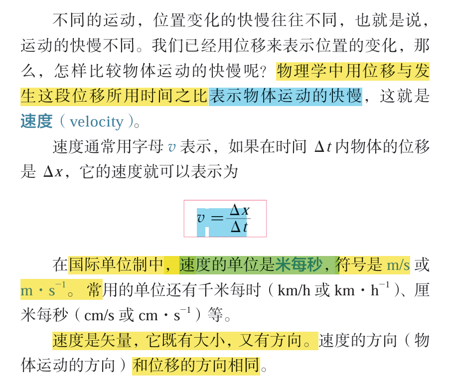
   2. 在第10张PPT前面插入图片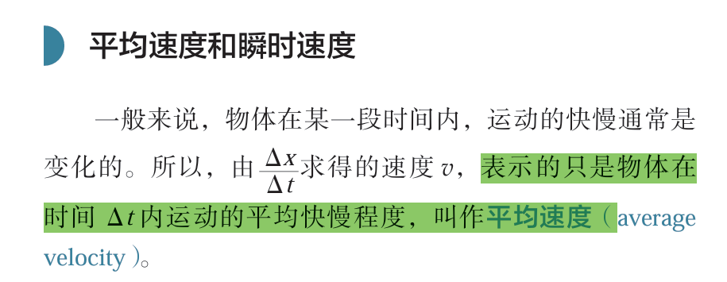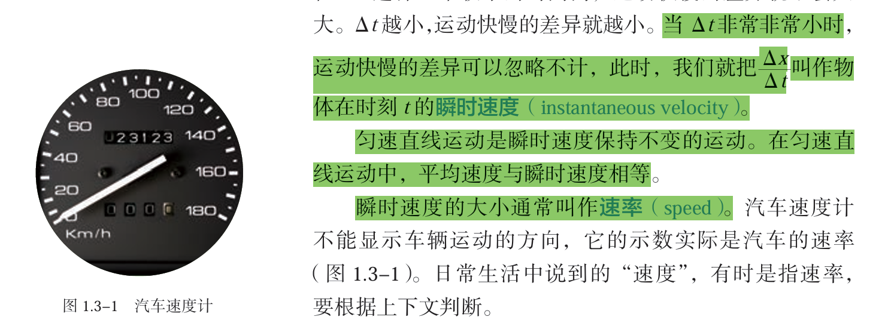
   3. 在第23张PPT前面插入图片
      1. 单独一张PPT测量平均速度：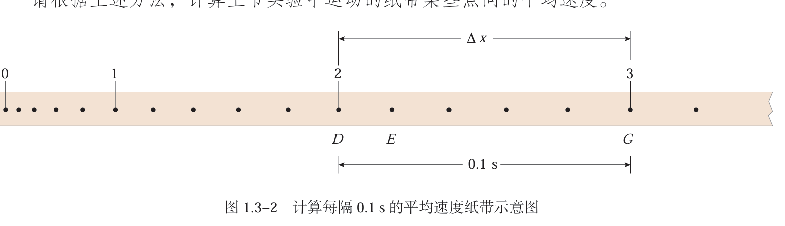测量总思路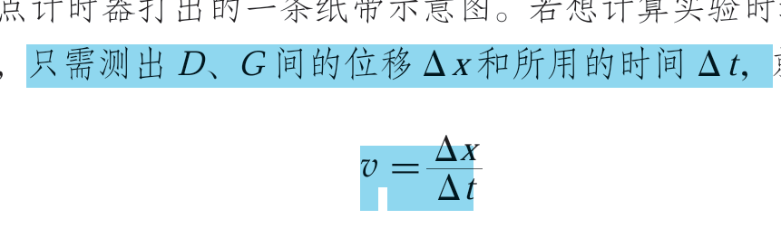时间的测量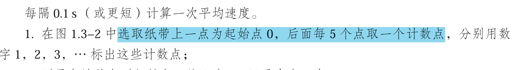
      2. 单独一张PPT测量瞬时速度：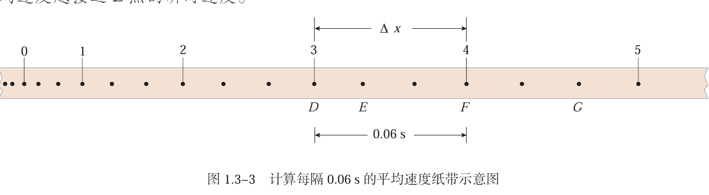测量思路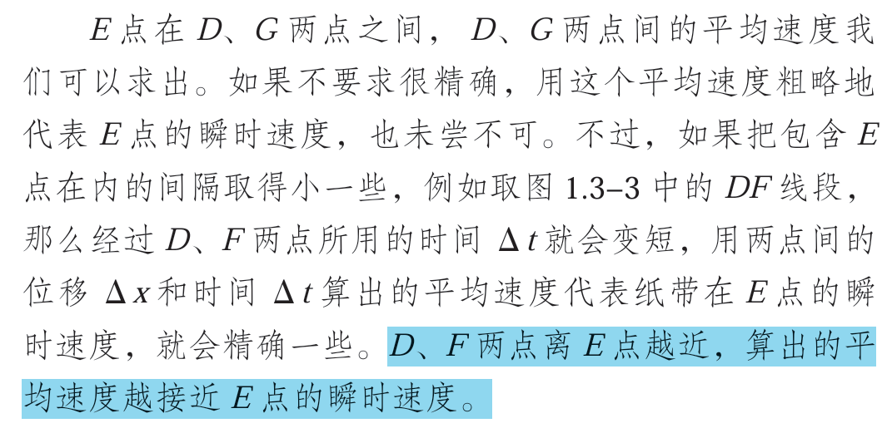时间的测量 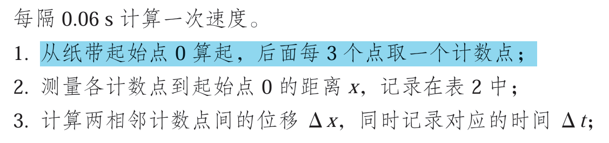
   4. 在第31张PPT后面插入图片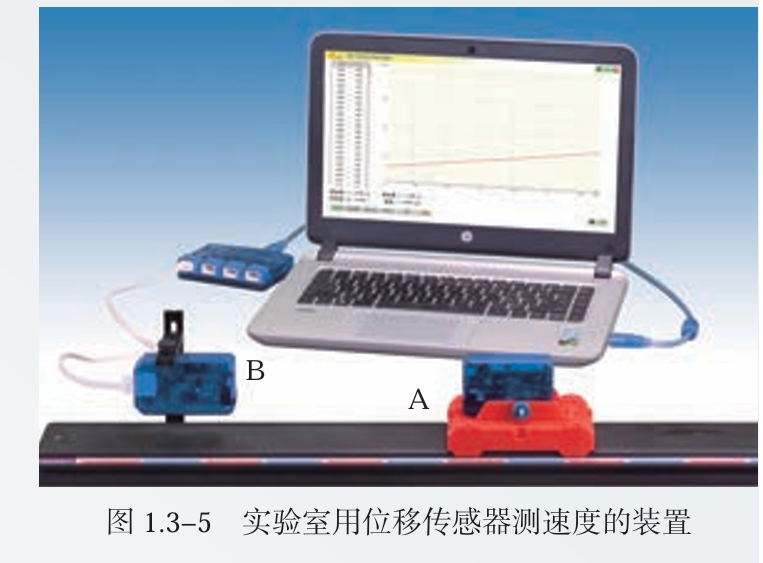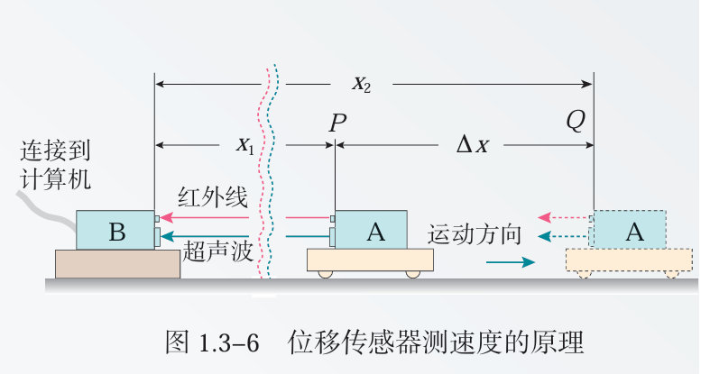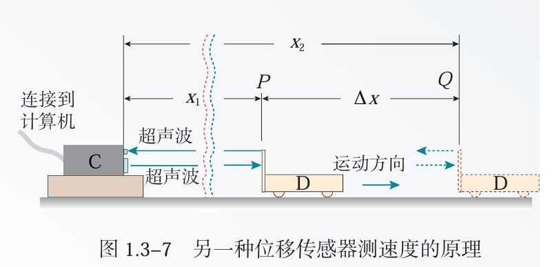
   5. 在第32张PPT前面插入图片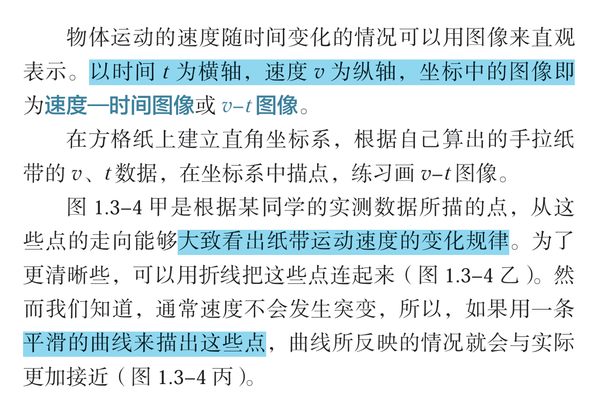
2. 不改动原有PPT行文思路；
3.  在每一个环节增加趣味性，可以在每一个环节的前面或者结束部分，新增情境或者游戏或者小结互动的内容；

