# 2.3 匀变速直线运动的位移与时间的关系（下）

> 视频： [2.3匀变速直线运动的位移与时间的关系（下）](https://www.bilibili.com/video/BV1rq4y1M7XK/?spm_id_from=333.788.videopod.episodes&vd_source=c317ed9348591eec2fb6f3081168a7bf&p=9)  
> UP：正说物理；视频时长约 43 分 35 秒。以下时间点按播放器显示值记录，个别截图为跳转后的近似时刻。

## 一、老师的讲课主线

这节课不是直接背结论，而是沿着“已有公式 → 特殊情形发现规律 → 图象解释 → 一般化 → 实验验证 → 习题应用”的路线推进：

1. **从速度位移公式继续追问**：利用 \(v^2-v_0^2=2ax\)，观察相同位移对应的速度平方差，并讨论中间位置的瞬时速度。
2. **把问题具体化为 \(v_0=0\)**：让物体每隔相同距离或相同时间取点，比较末速度、总时间和每一段时间，发现根号比例。
3. **转到 \(v-t\) 图象**：把相等时间段的位移看成图象下的面积，用矩形面积差说明“相邻相等时间段位移差相等”。
4. **由特殊项推广到任意项**：得到 \(x_m-x_n=(m-n)at^2\)，并提醒 \(x_i\) 表示各个相等时间段内的位移时，不能误当成位置坐标。
5. **回到实验**：用多组点迹数据分别估计 \(a_1,a_2,a_3\)，再用平均值检验规律，强调用多组数据减小偶然误差。
6. **结尾练习**：给出 \(x_1,x_2,\ldots\) 的编号，通过“错位配对、逐项相减”计算组合式，检查是否真正理解通项关系。

## 二、板书知识点

### 1. 等位移问题：速度平方差

由

\[
v^2-v_0^2=2ax
\]

可知，在匀变速直线运动中，若连续两段位移相等，则对应的速度平方差相等：

\[
v_2^2-v_1^2=v_1^2-v_0^2=2a\Delta x.
\]

因此，经过中点位置时的瞬时速度不是简单的 \((v_0+v)/2\)，而是

\[
\boxed{v_{x/2}=\sqrt{\frac{v_0^2+v^2}{2}}}.
\]

老师同时对比了“中间位置的瞬时速度”和“中间时刻的速度”（后者在匀变速运动中为 \((v_0+v)/2\)），提醒二者一般不相等。

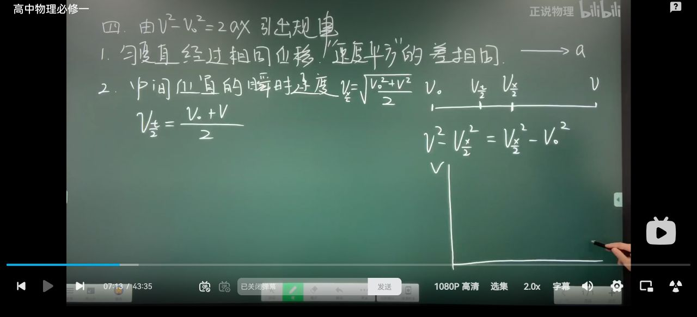

### 2. 初速度为零时的比例规律

设 \(v_0=0\)，加速度为 \(a\)。由 \(v^2=2ax\) 得：

#### （1）前 \(1\,\mathrm m\)、前 \(2\,\mathrm m\)、……末速度之比

\[
v_1:v_2:v_3:\cdots=1:\sqrt2:\sqrt3:\cdots:\sqrt n.
\]

这说明：位移按整数倍增加时，速度按根号增加，而不是按整数倍增加。

#### （2）前 \(1\,\mathrm m\)、前 \(2\,\mathrm m\)、……所用总时间之比

由 \(x=\frac12at^2\) 得 \(t=\sqrt{2x/a}\)，所以

\[
t_1:t_2:t_3:\cdots=1:\sqrt2:\sqrt3:\cdots:\sqrt n.
\]

#### （3）连续相等位移段所用时间之比

第 \(1\,\mathrm m\)、第 \(2\,\mathrm m\)、第 \(3\,\mathrm m\)、……各段的时间为相邻总时间之差，因此

\[
\Delta t_1:\Delta t_2:\Delta t_3:\cdots
=1:(\sqrt2-1):(\sqrt3-\sqrt2):\cdots.
\]

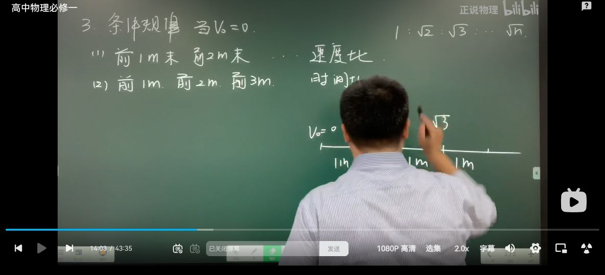

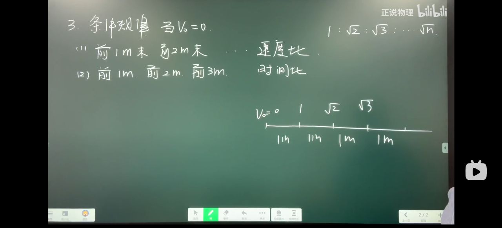

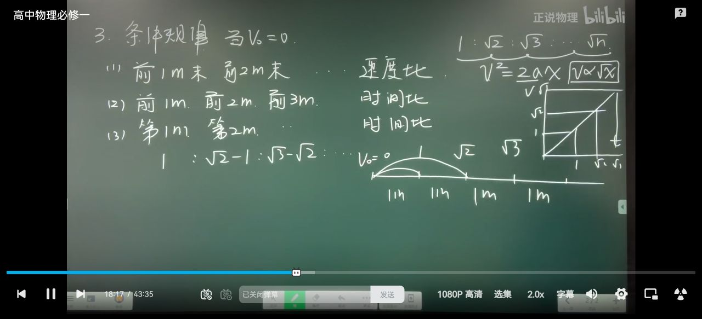

### 3. 相等时间段的位移差

将运动按相等时间间隔 \(t\) 取段，每一段位移记为 \(x_1,x_2,x_3,\ldots\)。老师先用图象和面积说明：

\[
\boxed{x_2-x_1=x_3-x_2=\cdots=at^2}.
\]

这里的 \(x_i\) 是**第 \(i\) 个相等时间段内的位移**，不是同一物体在第 \(i\) 时刻的位置坐标。

从 \(v-t\) 图象看，第 \(i+1\) 段与第 \(i\) 段的位移分别是对应的梯形面积；两面积相减后只剩一个底为 \(t\)、高为 \(at\) 的小矩形，面积为 \(at^2\)。

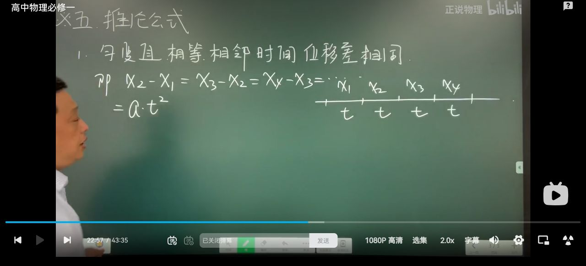

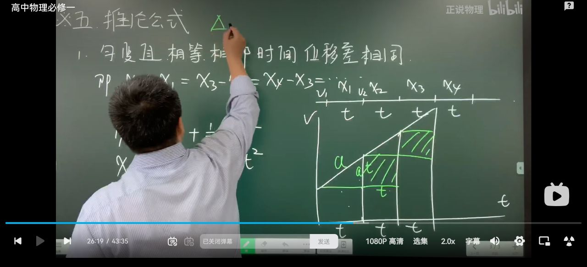

### 4. 通项推广

由相邻项逐差相等，推广到任意两项：

\[
\boxed{x_m-x_n=(m-n)at^2}.
\]

例如：

\[
x_4-x_1=3at^2,
\]

而 \(x_2-x_1=at^2,\;x_3-x_2=at^2,\;x_4-x_3=at^2\)。做题时先确认编号代表“相等时间段”，再用项数差乘 \(at^2\)。

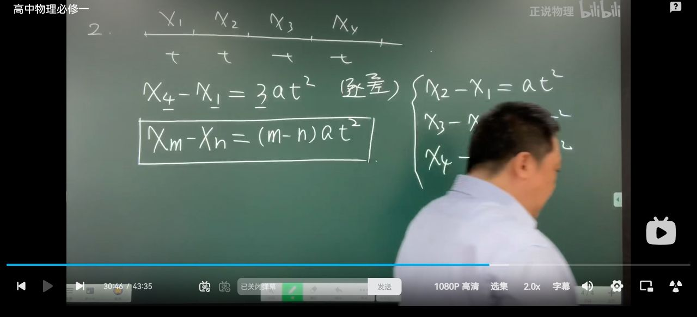

## 三、实验验证思路

板书进入“实验验证”后，老师把连续点迹（或连续相等时间段）编号为 \(x_1,x_2,\ldots\)，分别取三组相隔三个时间段的数据：

\[
\begin{aligned}
x_4-x_1&=3a_1t^2,\\
x_5-x_2&=3a_2t^2,\\
x_6-x_3&=3a_3t^2.
\end{aligned}
\]

对三次测量取平均：

\[
\bar a=\frac{a_1+a_2+a_3}{3}.
\]

把三式相加，得到

\[
(x_4+x_5+x_6)-(x_1+x_2+x_3)
=3t^2(a_1+a_2+a_3)
=\boxed{9\bar a t^2}.
\]

这个过程体现了实验数据处理中“多组测量、先分别计算、再取平均”的思路。

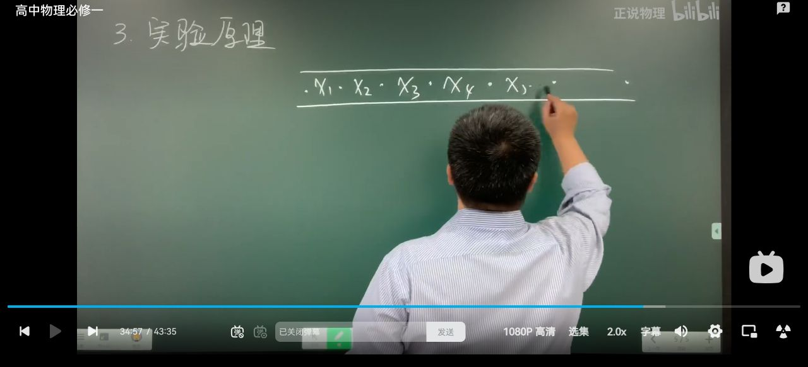

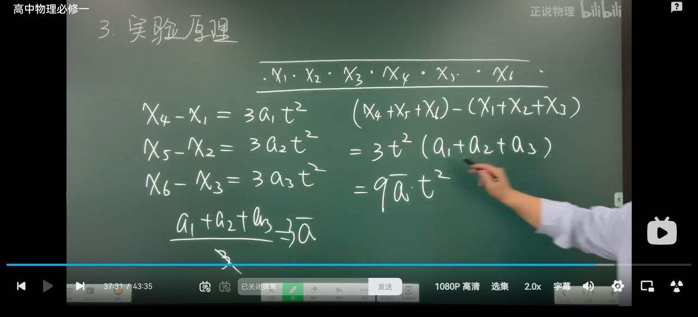

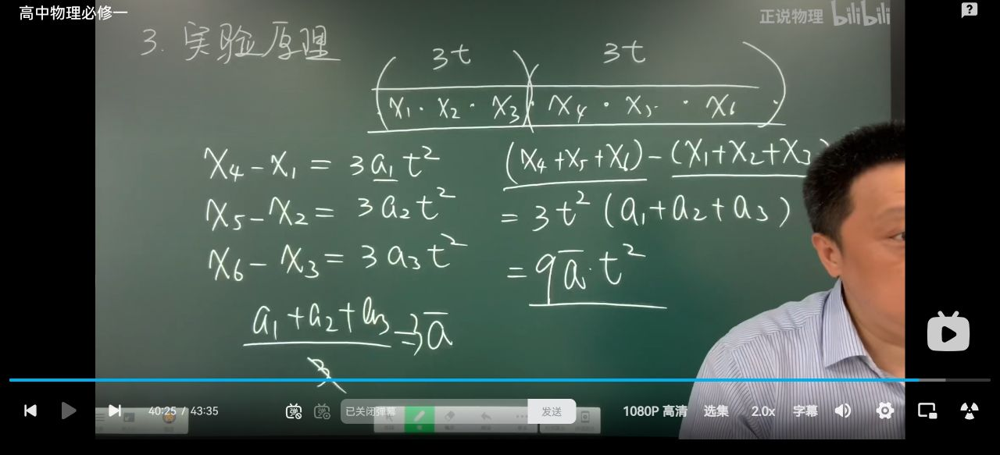

## 四、结尾习题：编号组合式

视频结尾在 \(x_1,x_2,\ldots,x_7\) 的编号轴上考察

\[
(x_5+x_6+x_7)-(x_1+x_2+x_3).
\]

逐项错位配对：

\[
(x_5-x_1)+(x_6-x_2)+(x_7-x_3).
\]

每一项的编号差都是 \(4\)，所以若各段时间均为 \(t\)，由通项关系可得

\[
(x_5+x_6+x_7)-(x_1+x_2+x_3)
=4at^2+4at^2+4at^2
=\boxed{12at^2}.
\]

解题关键是先“拆成差”，再检查每一对的编号差是否相同。

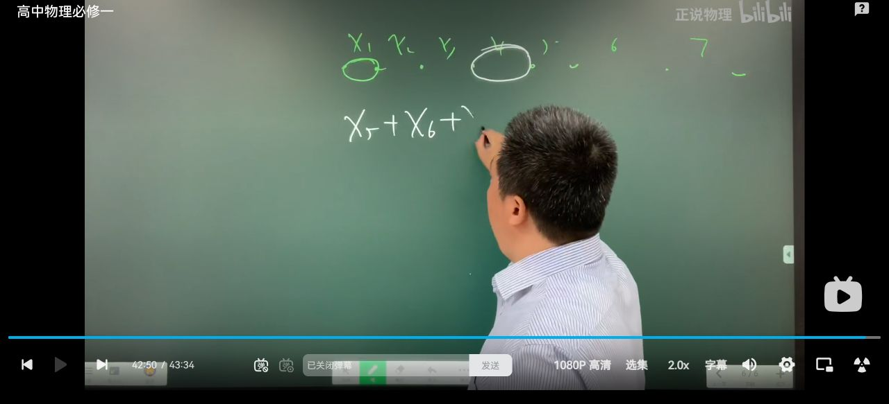

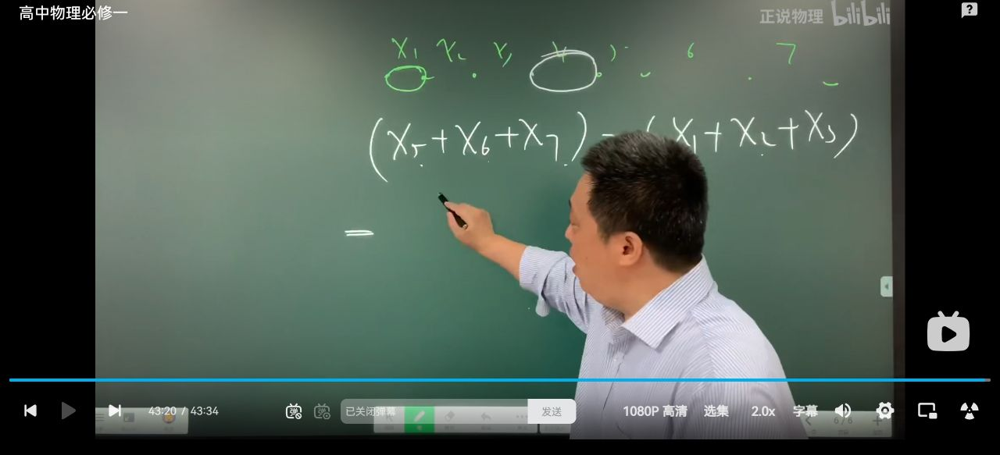

## 五、易错点与听课提示

- \(v_0=0\) 是特殊情形，不能把 \(1:\sqrt2:\sqrt3\) 的结论直接套到任意初速度。
- “前 \(n\,\mathrm m\)”是从起点到第 \(n\,\mathrm m\) 的总量；“第 \(n\,\mathrm m\)”是连续相等位移中的某一段，二者的时间含义不同。
- \(x_i\) 在本节板书中常表示“第 \(i\) 个相等时间段的位移”，做题前必须确认符号定义。
- 速度 \(v-t\) 图象下的面积表示位移；相邻梯形面积之差才对应 \(x_{i+1}-x_i\)。
- 看到 \(x_m-x_n\) 时先数编号差 \(m-n\)，不要把 \(m,n\) 当成时间或位置的数值。
- 实验验证用平均加速度，是为了减小单次测量误差；不能只用一组数据就下结论。

## 六、课后自测

1. 物体从静止开始做匀加速直线运动，经过 \(1\,\mathrm m\)、\(4\,\mathrm m\) 时的速度之比是多少？
2. 将运动按相等时间 \(t\) 分成若干段，若 \(x_3-x_1=2at^2\)，则 \(x_6-x_2\) 是多少？
3. 已知 \(x_1,\ldots,x_7\) 为相等时间段位移，求 \((x_6+x_7)-(x_1+x_2)\)。

**参考答案**：

1. \(1:2\)；
2. \(4at^2\)；
3. \((x_6-x_1)+(x_7-x_2)=5at^2+5at^2=10at^2\)。

## 七、截图目录

全部板书截图保存在本目录的 `板书截图/` 文件夹中；上文按讲课顺序嵌入了关键知识点、图象推导、实验验证和结尾习题截图。
