# 2.3 匀变速直线运动的位移与时间的关系（中）

> 视频：[2.3匀变速直线运动的位移与时间的关系（中）](https://www.bilibili.com/video/BV1rq4y1M7XK/?spm_id_from=333.788.videopod.episodes&vd_source=c317ed9348591eec2fb6f3081168a7bf&p=8)  
> UP：正说物理；时长约 39 分 38 秒。时间点按播放器显示值记录，截图为对应板书或习题画面。

## 一、老师的讲课思路

本集围绕“位移公式如何使用、如何从公式读出规律”展开，讲解顺序是：

1. **公式扩展**：先写出匀变速直线运动的两个基本式 \(v=v_0+at\) 与 \(x=v_0t+\frac12at^2\)，再将它们用于特殊情形。
2. **初速度为零的规律**：令 \(v_0=0\)，得到 \(x=\frac12at^2\)，讨论位移与时间平方成正比，以及速度比、总位移比、分段位移比。
3. **典型例题**：利用“前 \(1\,\mathrm m\)”和“前 \(2\,\mathrm m\)”的时间关系列方程，先求加速度，再求某一时刻速度。
4. **图象解释**：在 \(v-t\) 图象中用面积表示位移，在 \(x-t\) 图象中观察抛物线形状，比较 \(v_0\neq0\) 与 \(v_0=0\) 的图线。
5. **回到速度—位移关系**：总结 \(v^2-v_0^2=2ax\)，用 \(a\)、\(x\) 的符号判断加速或减速。
6. **内涵与结尾练习**：强调“相同时间不代表速度变化量相同”“相同位移也不代表时间相同”，并用相邻时间段、相邻位移段的比较题收束。

## 二、公式扩展

匀变速直线运动的速度公式和位移公式为

$$
v=v_0+at
$$

$$
x=v_0t+\frac12at^2
$$

若取初速度 \(v_0=0\)，则

$$
v=at,\qquad x=\frac12at^2
$$

因此在 \(a\) 不变时

$$
x\propto t^2.
$$

这一步是后面所有比例规律和图象判断的基础：时间扩大为原来的 \(n\) 倍，位移扩大为原来的 \(n^2\) 倍。

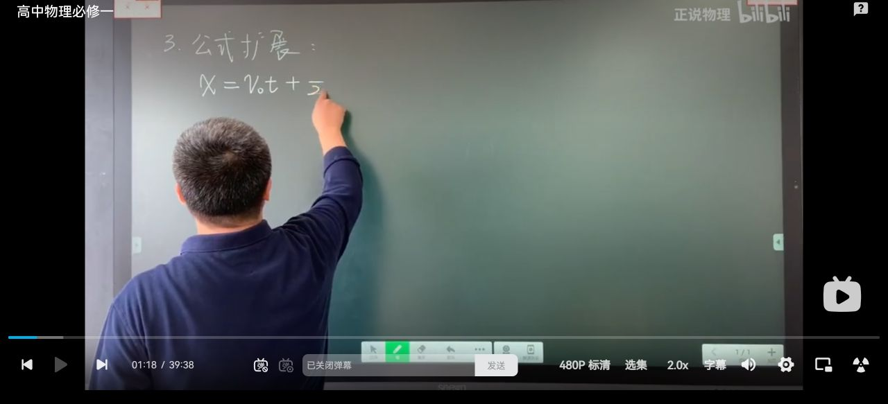

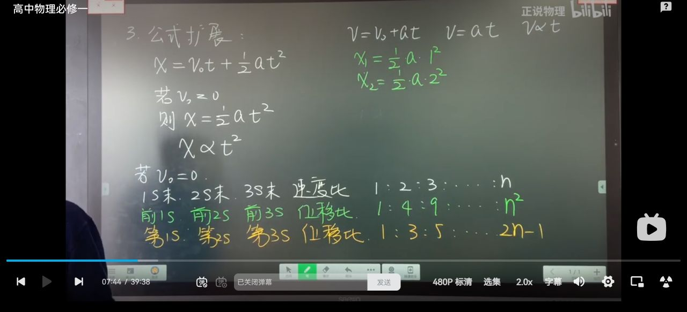

## 三、初速度为零时的比例规律

### 1. 速度比

若物体从静止开始运动，经过相同的时间间隔 \(t\)、\(2t\)、\(3t\)、……，则

$$
v_1:v_2:v_3:\cdots=1:2:3:\cdots:n.
$$

### 2. 前 \(1\,\mathrm s\)、前 \(2\,\mathrm s\)、前 \(3\,\mathrm s\) 的位移比

由 \(x=\frac12at^2\)，有

$$
x_1:x_2:x_3:\cdots=1:4:9:\cdots:n^2.
$$

### 3. 第 \(1\,\mathrm s\)、第 \(2\,\mathrm s\)、第 \(3\,\mathrm s\) 内的位移比

连续相等时间段内的位移要用“前 \(n\) 秒位移相减”得到：

$$
\Delta x_1=x_1,
$$

$$
\Delta x_2=x_2-x_1=4-1=3,
$$

$$
\Delta x_3=x_3-x_2=9-4=5.
$$

所以

$$
\Delta x_1:\Delta x_2:\Delta x_3:\cdots
=1:3:5:\cdots:(2n-1).
$$

老师特别区分了“前 \(n\,\mathrm s\)”和“第 \(n\,\mathrm s\) 内”：前者是从起点累计的总位移，后者是一个时间段内的位移。

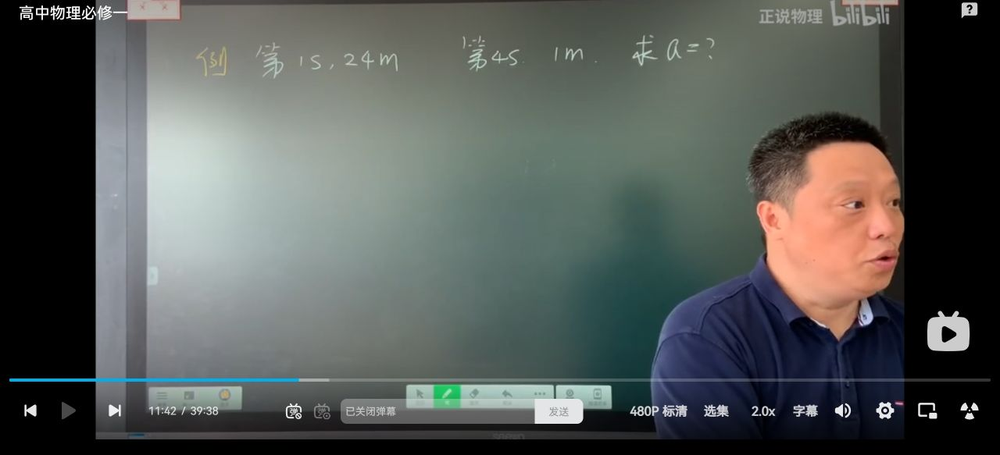

## 四、典型例题：用两个时间段的位移列式

板书例题先用时间线标出一个初始的 \(1\,\mathrm m\) 位移和后续的 \(24\,\mathrm m\) 位移，设初始段用时为 \(t\)。关键不是把“第几秒”误读成累计位移，而是按时间线写出两个位置（或两个时间段的位移）。

初始 \(1\,\mathrm m\) 段：

$$
1=\frac12at^2.
$$

后续 \(24\,\mathrm m\) 段用两个累计位移相减：

$$
24=\frac12a(t+3)^2-\frac12a(t+2)^2.
$$

两式联立即可先求 \(t\)，再代回求 \(a\)。若要求初始 \(1\,\mathrm m\) 末速度，使用

$$
v=at
$$

或

$$
v^2=2ax.
$$

解题顺序是“先画时间线 → 写累计位移之差 → 消元 → 回代”。不要把“第 \(1\,\mathrm m\)”误读成“第 \(1\,\mathrm s\)”，也不要把某一时间段的位移直接写成从 \(t=0\) 开始的总位移。

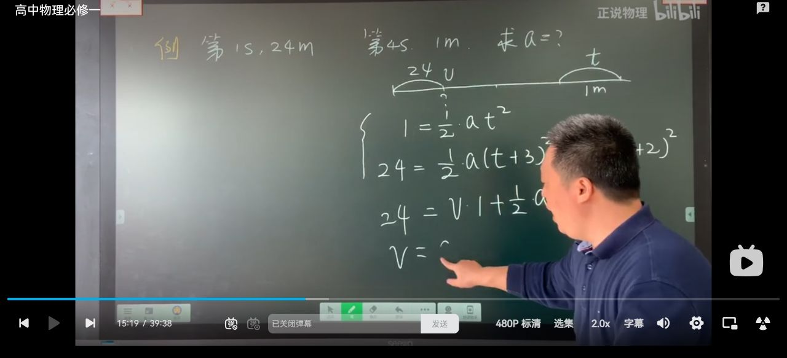

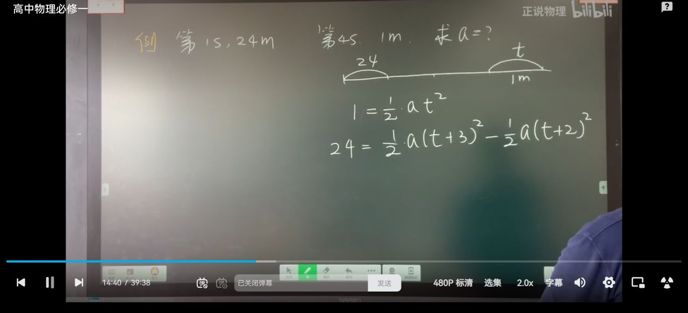

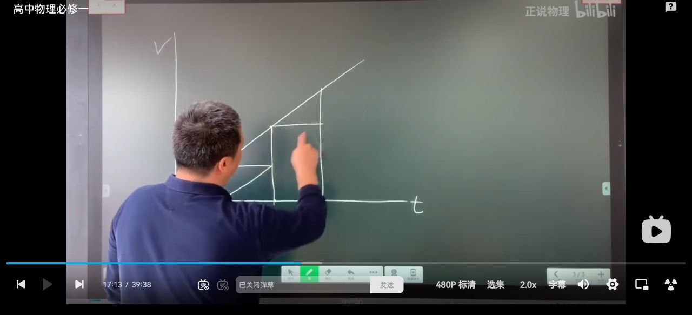

## 五、用图象理解位移公式

### 1. \(v-t\) 图象下面积表示位移

当速度随时间均匀变化时，\(v-t\) 图线是一条直线。图线与时间轴围成的面积就是位移：

$$
x=\text{图线与 }t\text{ 轴所围面积}.
$$

若 \(v_0\neq0\)，面积是梯形：

$$
x=\frac{(v_0+v)t}{2}
=\frac{(v_0+v_0+at)t}{2}
=v_0t+\frac12at^2.
$$

若 \(v_0=0\)，面积退化为三角形：

$$
x=\frac12vt=\frac12at^2.
$$

老师通过把梯形拆成矩形和三角形，直观说明了位移公式中两项 \(v_0t\) 与 \(\frac12at^2\) 的来源。

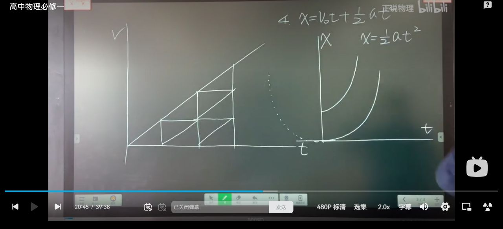

### 2. \(x-t\) 图象形状

位移公式

$$
x=v_0t+\frac12at^2
$$

是时间 \(t\) 的二次函数，因此 \(x-t\) 图象通常是抛物线：

- \(v_0=0\) 时，图线从原点出发；
- \(v_0\neq0\) 时，图线在 \(t=0\) 处具有初始斜率；
- 图线的切线斜率表示瞬时速度；
- 加速度决定图线弯曲方向和弯曲程度。

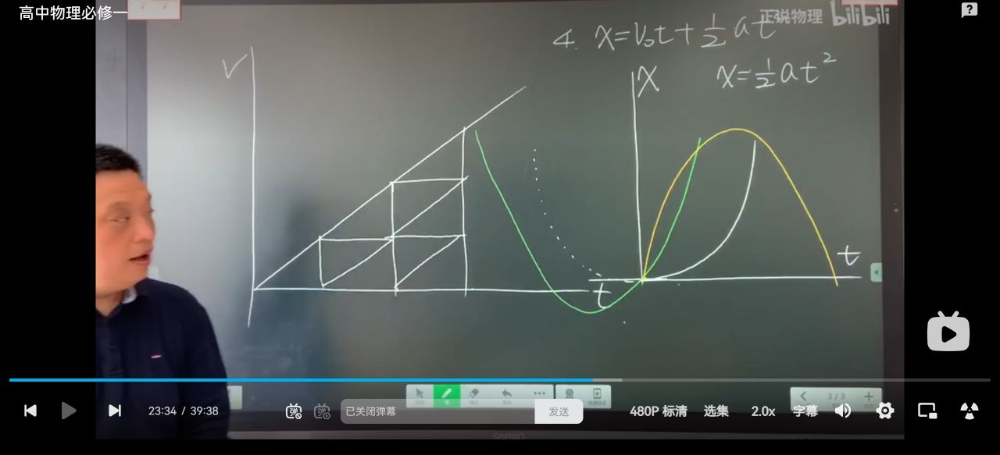

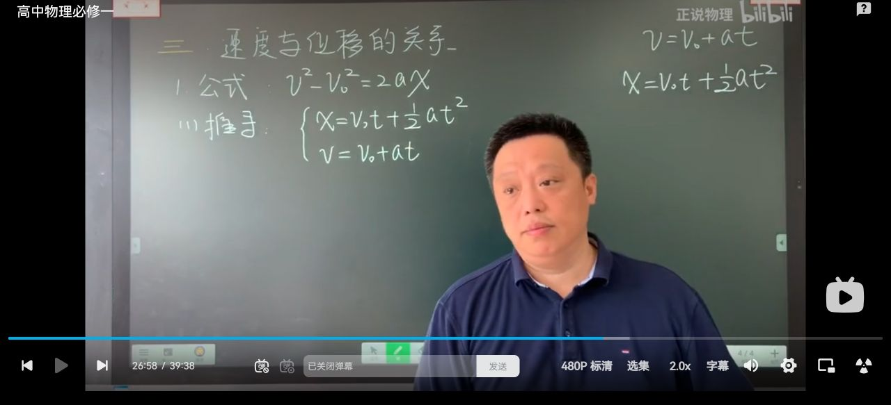

## 六、速度与位移的关系

除 \(v-t\) 和 \(x-t\) 两类图象外，本集再次总结速度—位移关系：

$$
\boxed{v^2-v_0^2=2ax}.
$$

它适用于不需要显式知道时间的题目。使用时必须统一正方向，并把 \(a\)、\(x\) 当作带符号的物理量。

### 加速、减速的符号判断

- 若 \(a>0,\;x>0\)，则 \(v^2>v_0^2\)，速度大小增大，表现为加速；
- 若 \(a<0,\;x>0\)，则 \(v^2<v_0^2\)，速度大小减小，表现为减速；
- 若 \(a<0,\;x<0\)，则 \(ax>0\)，仍有 \(v^2>v_0^2\)，速度大小增大；
- 判断“加速还是减速”要看速度大小是否增大，不能只看加速度正负。

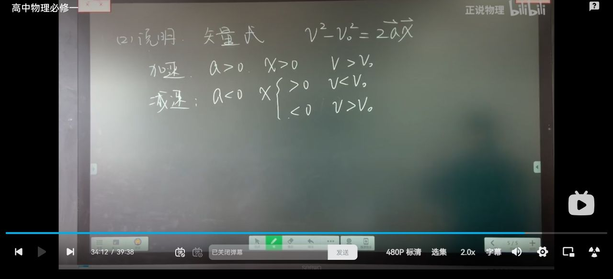

## 七、结尾内涵与习题

老师最后强调两个比较原则：

### 1. 相同时间不一定有相同的速度变化量

对于匀变速运动，若加速度恒定，则相同时间间隔内

$$
\Delta v=a\Delta t
$$

相同；但如果题目比较的是不同运动或不同加速度，不能仅凭“时间相同”判断 \(\Delta v\) 相同。

### 2. 相同位移不一定有相同的时间

时间还取决于初速度和加速度。只有在相同运动状态、相同加速度条件下，才可以根据公式比较。初速度为零时，连续相等位移段的时间越来越短；相等时间段的位移越来越大。

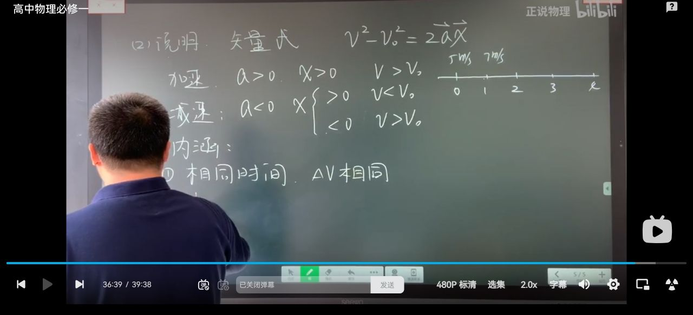

### 3. 相邻时间段与相邻位移段

在初速度为零的匀加速运动中，若每段时间均为 \(t\)，则每段位移呈

$$
1:3:5:\cdots:(2n-1)
$$

的奇数比；若每段位移相等，则对应时间间隔逐渐减小。板书用速度刻度和位置刻度对比了这一点，并提醒不要把“相同时间”和“相同位移”混为一谈。

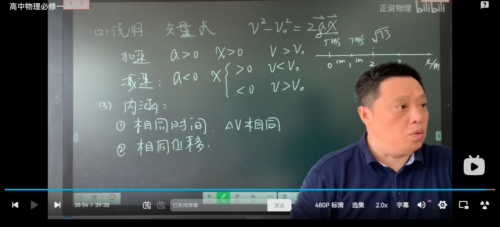

## 八、听课后的易错清单

- \(x\propto t^2\) 只是在 \(v_0=0\)、\(a\) 恒定时成立；有初速度时不能直接套用。
- “前 \(n\) 秒”对应总位移，“第 \(n\) 秒内”对应分段位移，二者比例不同。
- \(v-t\) 图象面积是位移，图线斜率是加速度；不要把两者含义混淆。
- \(x-t\) 图象不是运动轨迹，切线斜率才表示速度。
- 用 \(v^2-v_0^2=2ax\) 判断加减速时，必须保留 \(a\) 和 \(x\) 的符号。
- 题目给“前 \(1\,\mathrm m\)、前 \(2\,\mathrm m\)”时，先把它们视作累计位移，再列式求时间。

## 九、课后自测

1. 物体从静止开始做匀加速直线运动，前 \(1\,\mathrm s\)、前 \(2\,\mathrm s\) 的位移之比是多少？第 \(2\,\mathrm s\) 内与第 \(1\,\mathrm s\) 内的位移之比是多少？
2. \(v_0=2\,\mathrm{m/s}\)、\(a=3\,\mathrm{m/s^2}\)，求 \(t=4\,\mathrm s\) 内的位移。
3. 某段运动中 \(a<0\)、\(x<0\)，速度大小是增大还是减小？

**参考答案：**

1. \(1:4\)；\(3:1\)。
2. \(x=v_0t+\frac12at^2=8+24=32\,\mathrm m\)。
3. \(ax>0\)，所以 \(v^2>v_0^2\)，速度大小增大。

## 十、截图说明

本集板书截图集中保存在同目录的 \`中-板书截图/\` 文件夹中；笔记中已嵌入 13 张关键截图，覆盖公式、比例规律、例题、图象、加减速判断和结尾习题。
