# 4.1 牛顿第一定律

> 课堂视频（第 22 集，35:09） [4.1牛顿第一定律](https://www.bilibili.com/video/BV1rq4y1M7XK/?p=22)
>
> 主讲为哈尔滨六中郑筱平（正说物理）

## 导入　从运动学到动力学（00:53）

前两章研究物体怎样运动，这部分叫**运动学**。第四章开始研究运动和力的关系，这部分叫**动力学**。老师从历史上关于「力和运动是什么关系」的争论引入本节。

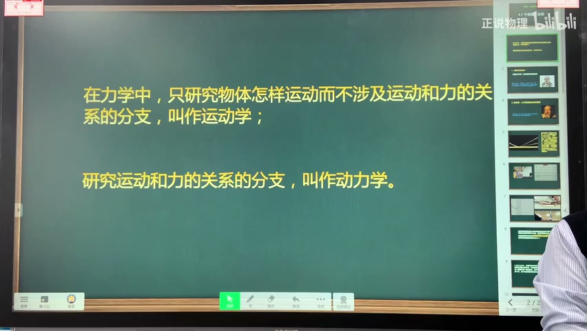

## 一、理想实验的魅力（01:40–12:55）

### 1. 亚里士多德从推拉物体的经验出发

推或拉物体能使它运动，停止推拉后，原来运动的物体常会停下来。亚里士多德根据这种经验，认为**力是维持运动的原因**。老师问这个判断漏掉了什么，引出运动中存在的摩擦力。

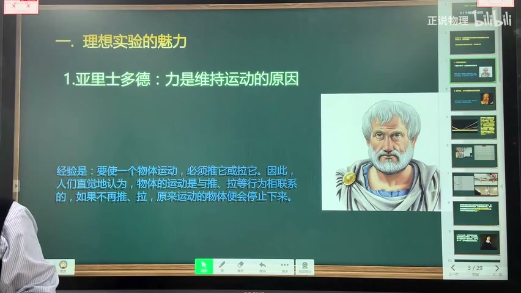

### 2. 伽利略用理想斜面研究摩擦的影响（03:10 起）

伽利略认为，摩擦使人们形成了运动必须靠力维持的印象。他用实验和推理提出，物体的运动无需力来维持。

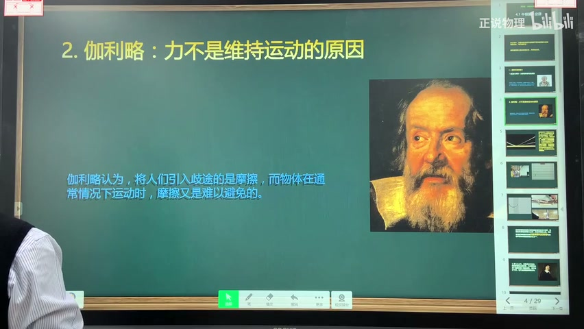

老师按课件上的图讲理想斜面。

1. 让小球从第一个斜面上的某一高度由静止滚下，再冲上第二个斜面。若没有摩擦，它会到达与释放点相同的高度。
2. 逐渐减小第二个斜面的倾角。小球仍要到达原来的高度，走过的路程就更长。
3. 把第二个斜面放平。在无摩擦的理想条件下，小球会在水平面上一直运动下去。

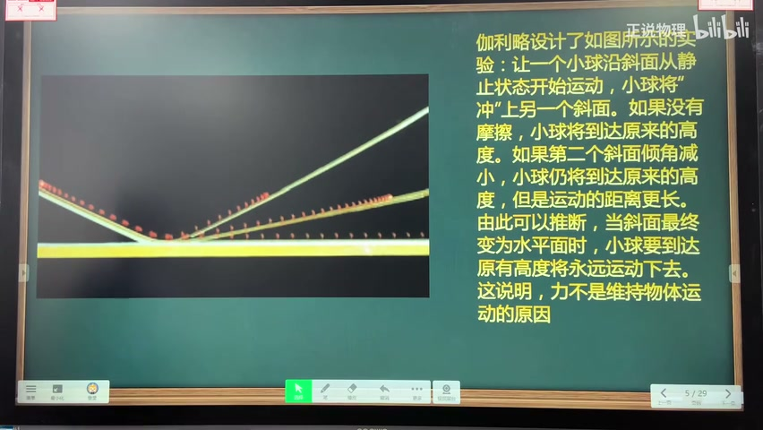

老师先用摆球说明「等高」。实际摆球放开后，能摆到接近释放点的高度。动画在摆线途中加一个钉子，另一侧的轨迹随之改变，理想情况下摆球仍能达到原来的高度。

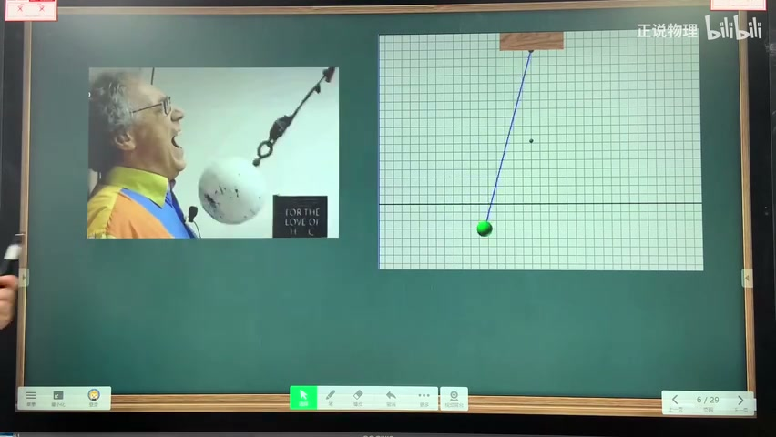

接着看小球在轨道上的演示。老师指着装有红色液体的连通器说明，液面可用来对照两侧的高度。真实轨道上，小球到达的高度偏低。轨道越光滑，越接近释放高度。老师据此引出**合理外推**，在真实实验的基础上，通过逻辑推理去掉摩擦的影响，再判断理想条件下的运动。他用先前学过的质点对照，说明这里理想化的是实验条件。

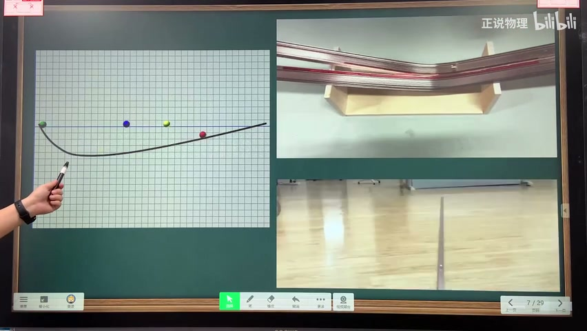

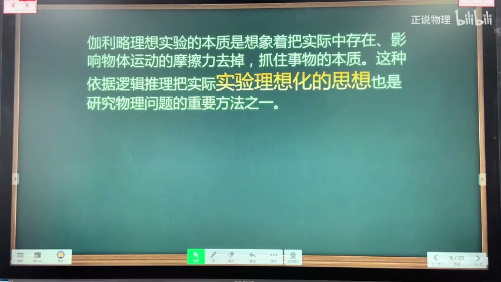

### 3. 笛卡尔把速度和方向说清楚（09:55 起）

如果运动中的物体没有受到力的作用，它将以同一速度沿同一直线继续运动。老师用「不会停下来，也不会偏离原来的方向」说明，笛卡尔在伽利略的结论上进一步说清了物体将怎样运动。

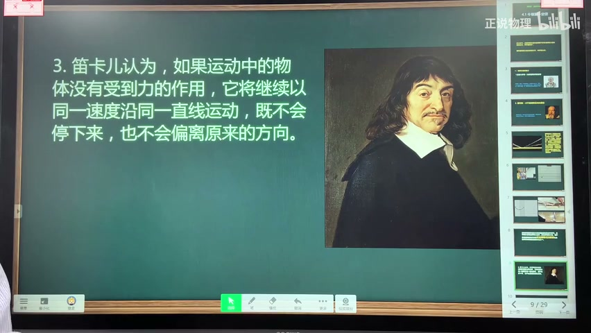

## 二、牛顿第一定律（12:55–32:30）

### 1. 定律的内容

一切物体总保持匀速直线运动状态或静止状态，除非作用在它上面的力迫使它改变这种状态。

老师分两层读这句话。第一层讲物体保持原来的静止或匀速直线运动状态，第二层讲力能够迫使这个状态改变。

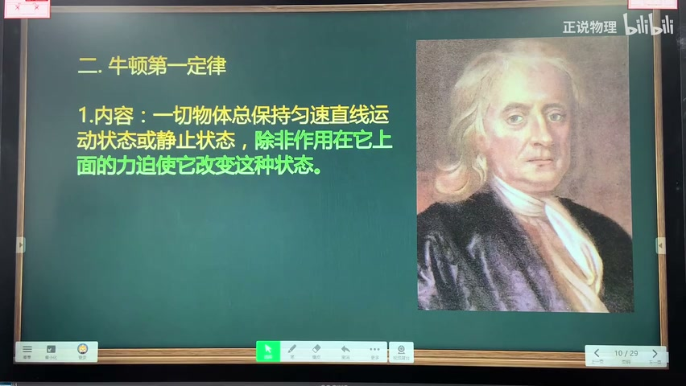

### 2. 惯性的含义和表现（14:50 起）

物体保持原来匀速直线运动状态或静止状态的性质，叫作**惯性**。老师把「保持原状态」换一种说法，称为物体抵抗运动状态变化的能力。牛顿第一定律也叫惯性定律。

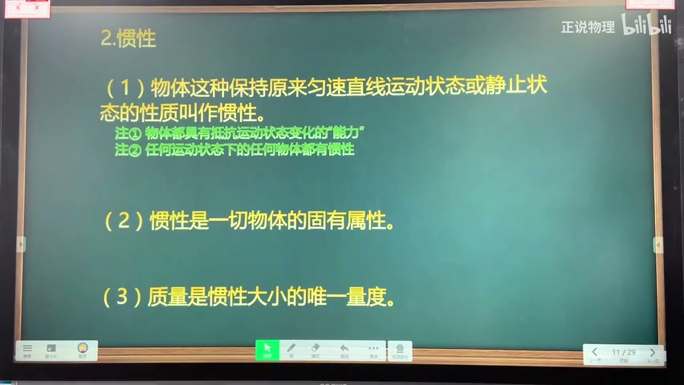

老师先用演示说明固体、液体和气体都有惯性。球带动拍面后，拍面上的灰尘倾向于保持原来的静止状态。装水的气球破裂时，水短时间内仍保持原来的形状。空气炮用烟圈把气流显示出来。载水的小车运动状态改变时，水仍有保持原来运动状态的趋势。

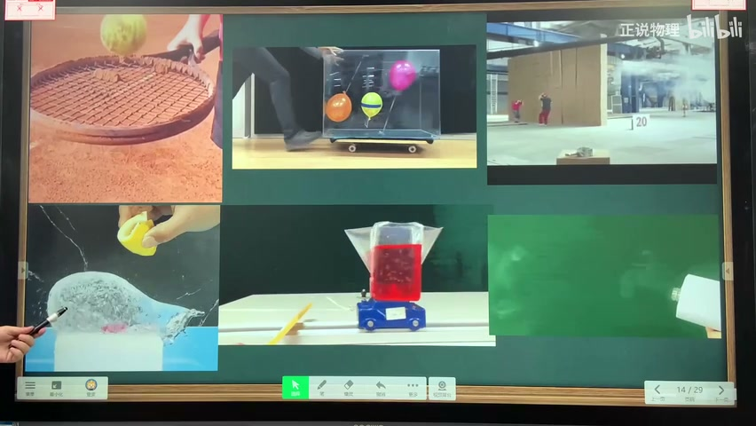

老师又比较了小车上透明箱里的三个气球。小车突然向前加速，密度较大的橙色气球相对车往后摆，轻的粉色气球向前摆。老师解释，还要考虑箱内的空气。空气相对箱子向后运动，把较轻的气球挤向前面。与箱内空气密度接近的气球作为对照。

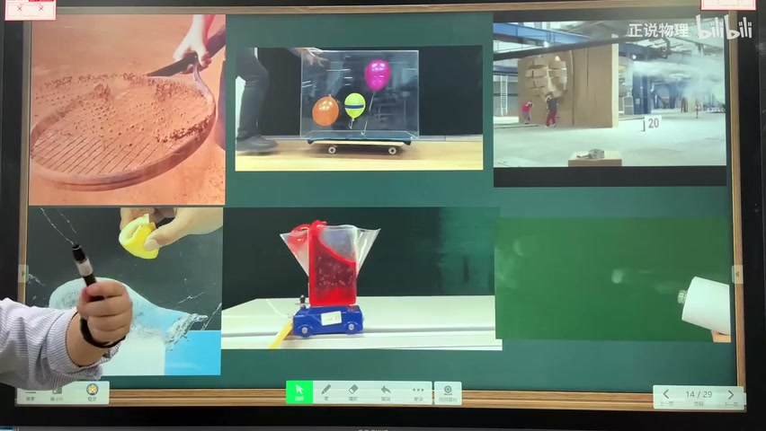

老师接着问，运动状态在改变的物体，怎样表现出惯性？他先让大家看圆盘中的小球。盘的侧壁给小球弹力，使它转弯。抽掉一段侧壁，小球离开后沿直线运动。接着他以正在下落的小球提问，假如重力在某一瞬间突然消失，小球会怎样运动？按课堂的设想，它会以当时的速度继续做匀速直线运动。老师由此回到板书，**惯性是一切物体的固有属性**，任何运动状态下的物体都有惯性。

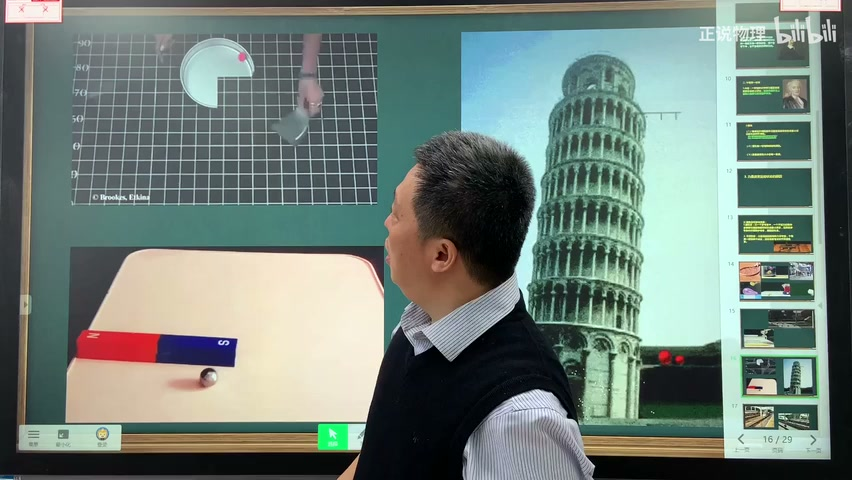

### 3. 用质量比较惯性大小（24:08 起）

**质量是惯性大小的唯一量度。** 老师设想在完全失重的环境里推动两个原来静止、质量不同的球。质量大的球更难推动，改变它的运动状态更困难。

老师接着放了货车制动后管材继续向前的画面，又用学校做的黄豆和小米分离实验说明惯性的应用。两种颗粒一起下落时，让气流从侧面吹过。质量较小的小米更容易改变运动状态，和质量较大的黄豆落到不同位置。

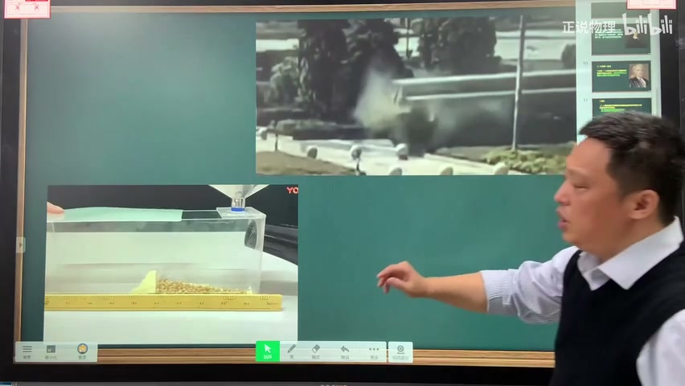

**课堂提问（28:29）**　质量相同的两列车，一列慢速进站，一列快速通过车站。慢车较容易停下来，能不能据此说它的惯性更小？

老师指出，两车都停下来时，各自需要改变的速度不同。比较时应让速度改变量相同。课堂上举的是快车由 $10\,\mathrm{m/s}$ 降到 $9\,\mathrm{m/s}$，慢车由 $1\,\mathrm{m/s}$ 降到 $0\,\mathrm{m/s}$，两次速度改变的大小都是 $1\,\mathrm{m/s}$。两车的质量相同，惯性大小相同。

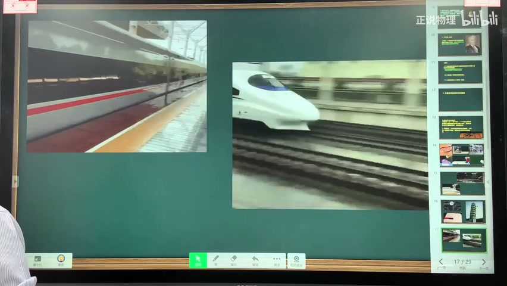

老师又放了快速抽走桌布和匀速前进时向上抛球的演示。桌布抽走时，原来静止的桌上物品只发生轻微晃动。抛球的人继续匀速向前，球在水平方向保持抛出时的速度，所以会落回手中。

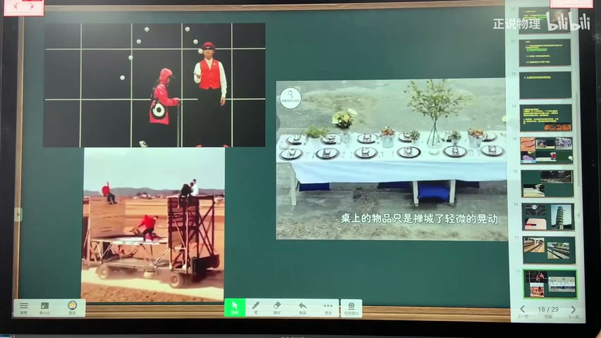

### 4. 力是改变运动状态的原因（31:40 起）

老师回到第一定律的后半句，把力和运动的关系归结为：**力是改变运动状态的原因。**

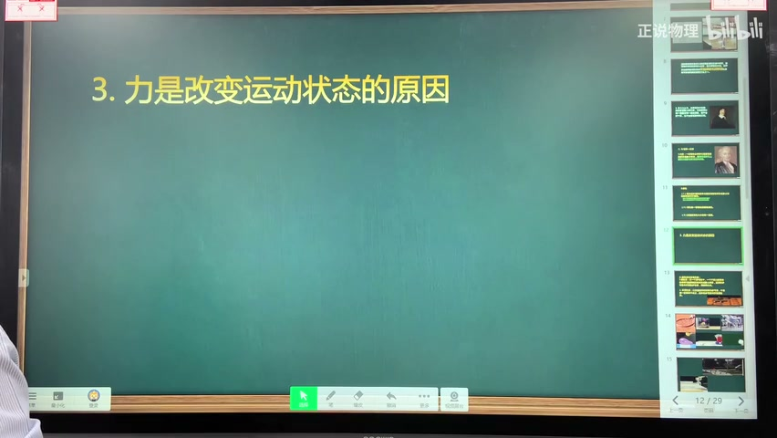

## 三、惯性系和非惯性系（32:30–35:09）

**惯性系**是这样的参考系：在其中，不受力的物体保持静止或匀速直线运动。牛顿第一定律在惯性系中成立。

老师播放小车被突然拉动的演示。车上的木块原来竖立。以加速的小车为参考系，木块看起来突然向后倒。老师让大家想一想，在车上观察时，木块并未受到一个向后的力，为什么会看到这种运动？由此引出**非惯性系**：以加速运动的物体为参考系，牛顿第一定律在这种参考系中不成立。

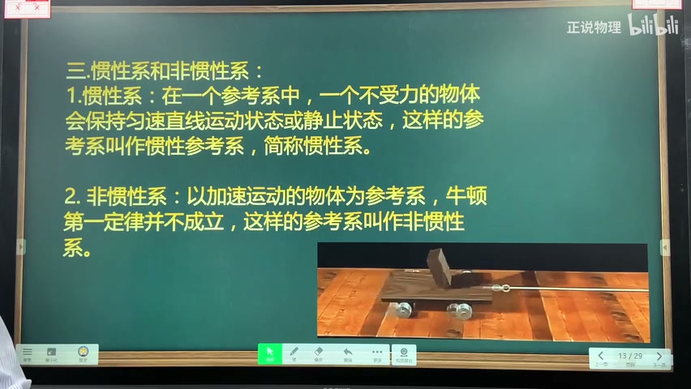

课末老师布置了以判断为主的作业，视频画面停留在参考系的课件上。
