# 4.2 探究加速度与力、质量的关系

> 来源：[正说物理《4.2实验：探究加速度与力、质量的关系》](https://www.bilibili.com/video/BV1rq4y1M7XK/?p=23)，第23集，约33分37秒。
>
> 按老师的讲课顺序整理，只记录本集讲解、课件和演示内容。文中时间为原视频时间，图片为原视频画面截图。

## 一、从牛顿第一定律引出实验问题（00:00—03:30）

老师先让同学们回顾牛顿第一定律，再抓住“外力使物体改变运动状态”这句话提问：

- 从动力学角度说，力改变物体的运动状态。
- 联系运动学中的加速度，思考加速度与力之间是否存在关系。
- 本节通过实验，研究加速度与力、质量之间的定量关系。

老师本节采用播放实验视频、边看边分析的方式讲解。

## 二、实验思路：控制变量（约03:30—06:20）

老师先展示小车通过细线、滑轮与悬挂钩码相连的装置，再把研究分为两部分。

### 1. 研究加速度与力的关系

保持小车的质量不变，通过改变悬挂钩码的个数，改变小车受到的拉力。测出不同拉力下小车的加速度，分析二者的变化关系。

这里先把钩码所受的重力近似看作小车受到的拉力；老师提示，这个近似所需要的条件后面还要讨论。

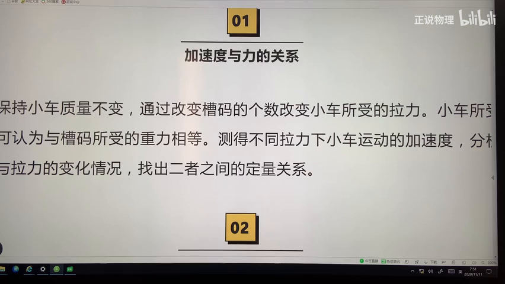

### 2. 研究加速度与质量的关系

保持小车受到的拉力不变，即保持悬挂钩码不变；通过在小车上增加重物，改变小车的质量。测出不同质量时小车的加速度，再分析二者的关系。

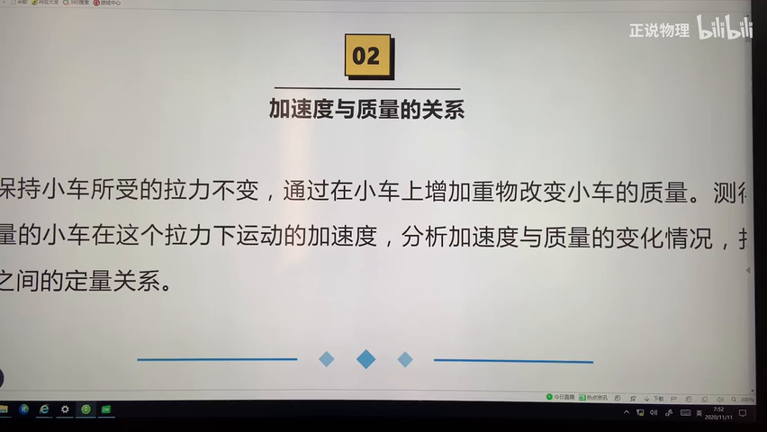

老师强调，这里用的是**控制变量的思想**：研究加速度与力的关系时，不能同时让质量变化；研究加速度与质量的关系时，要控制拉力不变。

随后，老师逐一落实三个量怎样测量：加速度利用打点计时器记录的纸带测量，质量用天平测量，力用悬挂钩码的重力近似表示。

## 三、实验方案一：用阻力补偿法探究（约06:20—13:45）

### 1. 实验器材与装置

课件列出的器材有：轨道、小车、砝码、钩码、垫块、打点计时器等。老师结合装置图，介绍悬挂钩码、纸带与小车的连接，以及打点计时器和电源。

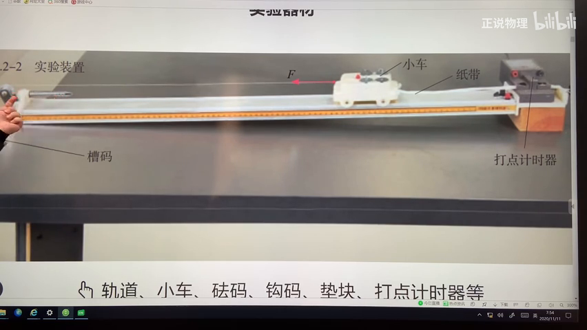

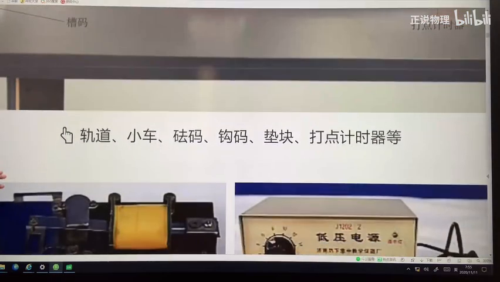

### 2. 组装实验

先组装轨道、小车和打点计时器等装置。让纸带穿过打点计时器，并把纸带的一端连接在小车上。悬挂物在平衡摩擦力时先不挂上。

### 3. 平衡摩擦力是重点

老师提出：如果小车运动时还受到阻力，就不能直接把悬挂钩码的重力当成使小车产生加速度的力，因此要先补偿阻力。

操作方法是：**把木板的一侧垫高，以补偿打点计时器对小车的阻力及其他阻力。**

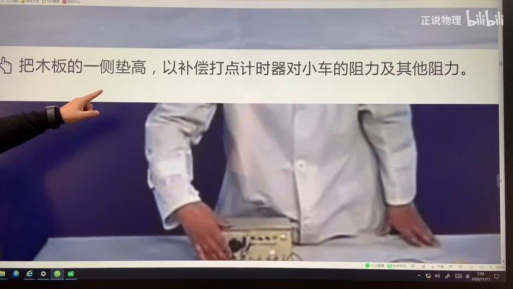

老师提醒，不能只凭“用手推一下，看起来像匀速运动”就认定已经平衡好。前面的推动是初步观察，还要通过纸带来判断。

调整木板的倾斜程度，使小车在不受牵引时，仍能拖动纸带沿木板匀速运动。接通打点计时器后，观察纸带上的点迹：**点的间距均匀，才表明小车做匀速运动，阻力得到补偿。**

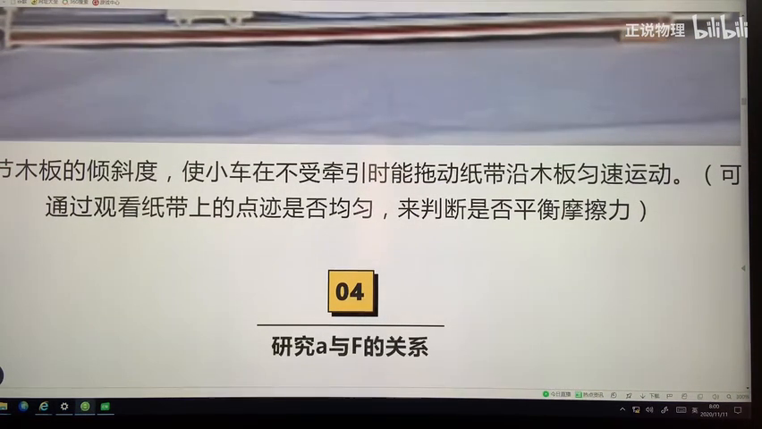

## 四、保持质量不变，研究加速度与力的关系（约13:45—17:50）

### 1. 测量与记录

平衡摩擦力后，再用悬挂钩码牵引小车。先接通电源，后释放小车，利用纸带上打出的点测量加速度。改变钩码个数，重复实验，得到不同拉力对应的加速度。

演示中，小车及车上砝码的总质量保持不变：

$$
M_{\text{车}}=(186.7+50\times6)\,\mathrm{g}=486.7\,\mathrm{g}
$$

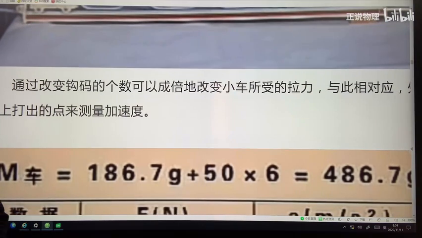

老师展示的数据如下：

| 次数 | 拉力 $F/\mathrm{N}$ | 加速度 $a/(\mathrm{m}\cdot\mathrm{s}^{-2})$ |
| --- | ---: | ---: |
| 1 | 0.098 | 0.200 |
| 2 | 0.196 | 0.405 |
| 3 | 0.294 | 0.606 |
| 4 | 0.392 | 0.804 |
| 5 | 0.490 | 1.010 |

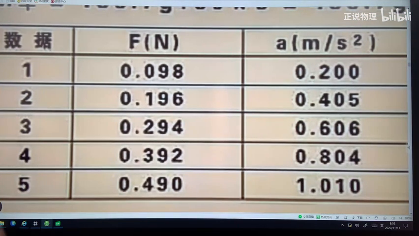

### 2. 描点作图，得到结论

以 $a$ 为纵坐标、$F$ 为横坐标建立直角坐标系，根据各组实验数据描点。各点在一条过原点的直线附近。

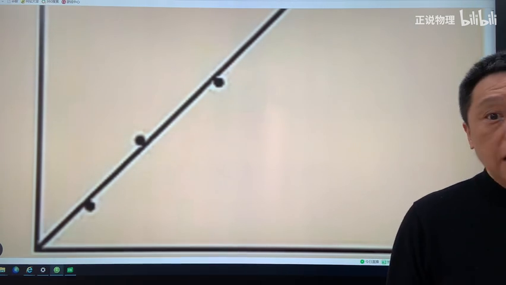

因此，在质量不变时，加速度与拉力成正比：

$$
a\propto F\qquad\text{（质量不变）}
$$

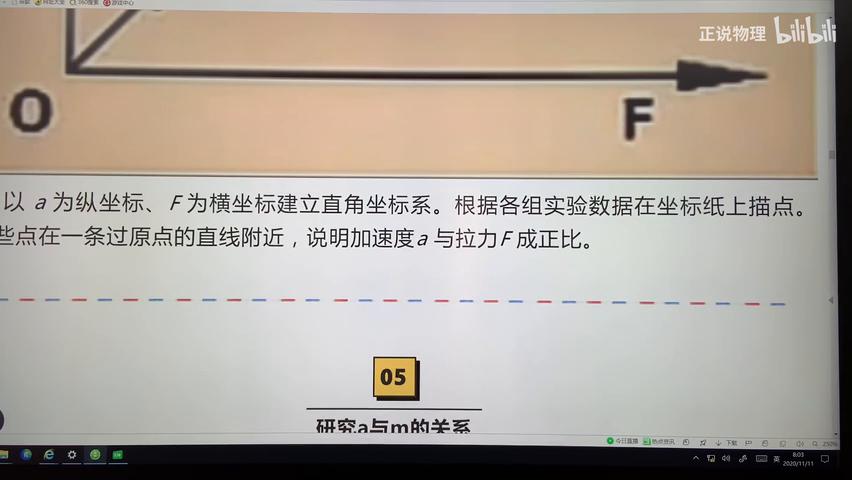

## 五、保持拉力不变，研究加速度与质量的关系（约17:50—22:55）

### 1. 改变小车质量，重新测量

保持悬挂钩码不变，改变小车及车上重物的总质量，重复测量加速度。

老师先从经验引导判断：在相同拉力作用下，质量越大，运动状态越难改变，加速度越小。但“越大、越小”还不能直接证明二者成反比，需要用实验数据检验。

课件中的数据为：

| 次数 | 质量 $m/\mathrm{kg}$ | 加速度 $a/(\mathrm{m}\cdot\mathrm{s}^{-2})$ | 质量倒数 $\dfrac{1}{m}/\mathrm{kg}^{-1}$ |
| --- | ---: | ---: | ---: |
| 1 | 0.25 | 0.618 | 4.00 |
| 2 | 0.29 | 0.557 | 3.45 |
| 3 | 0.33 | 0.482 | 3.03 |
| 4 | 0.40 | 0.403 | 2.50 |
| 5 | 0.50 | 0.317 | 2.00 |
| 6 | 0.71 | 0.235 | 1.41 |
| 7 | 1.00 | 0.152 | 1.00 |
| 8 | 1.67 | 0.086 | 0.60 |

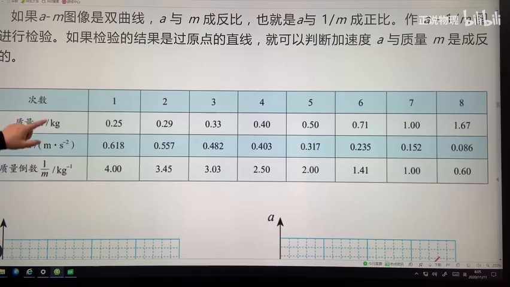

### 2. 从曲线改为直线检验

先画 $a-m$ 图像，得到一条下降的曲线。老师提出：不能只凭图像“看起来像双曲线”，就认定加速度与质量成反比，还可能是其他关系。

若加速度与质量成反比，就应当与质量的倒数成正比。因此，在表中计算每个质量的倒数，再画 $a-\dfrac{1}{m}$ 图像。

实验点在一条过原点的直线附近，从而判断：在拉力不变时，加速度与质量成反比。

$$
a\propto\frac{1}{m}\qquad\text{（拉力不变）}
$$

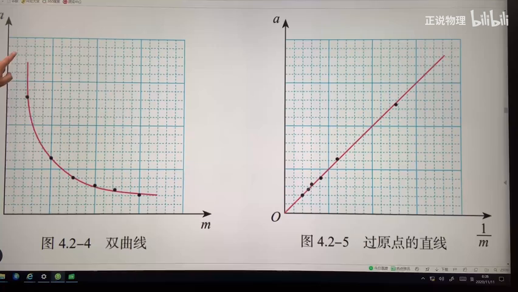

老师在这里回顾了本节的思路：先从运动状态的改变提出问题，再通过控制变量、测量数据和作图，检验加速度与力、质量之间的关系。

### 3. 老师特别强调：这里的力应当是合力

老师接着追问：实验中说加速度与拉力成正比，如果换成其他受力情况，又应该与什么力成正比？

几个力可以等效为一个合力。老师强调，加速度应当与物体受到的**合力**成正比，不能随意拿其中某一个力来对应。

这也解释了本实验为什么要平衡摩擦力：用重力沿斜面的分力补偿阻力后，牵引小车的拉力才对应小车受到的合力。

## 六、误差分析（约23:00—26:00）

### 1. 平衡摩擦力不准确

老师展示两条没有通过原点的 $a-F$ 直线，让同学们根据图像分析原因。

- **图线①：平衡摩擦过大。** 木板垫得过高，即使没有加拉力，小车也已经有加速度。
- **图线②：平衡摩擦不足。** 还存在未补偿的阻力，需要先加一定的力，才能使小车产生加速度；图上出现横轴截距 $F_0$。

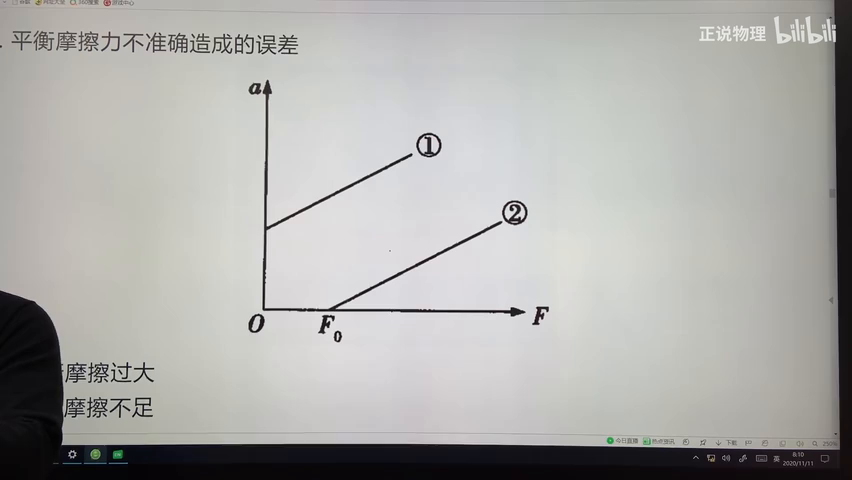

### 2. 用悬挂物重力代替拉力造成的误差

实验中用悬挂钩码的总重力代替小车受到的拉力。老师指出：**实际上，小车受到的拉力小于悬挂钩码的重力，存在系统误差。**

要使这种替代更接近实际，需要悬挂钩码的总质量远小于小车和车上砝码的总质量。

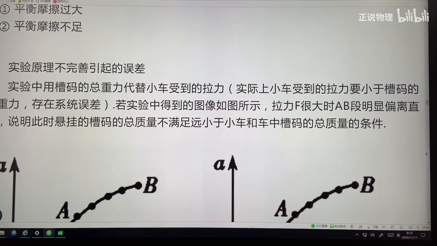

老师结合下图说明：当图像的 $AB$ 段明显偏离原来的直线时，说明相应实验条件下，悬挂物质量已经不满足“远小于小车总质量”的要求。课件同时列出了 $a-F$ 和 $a-\dfrac{1}{m}$ 两种图像。

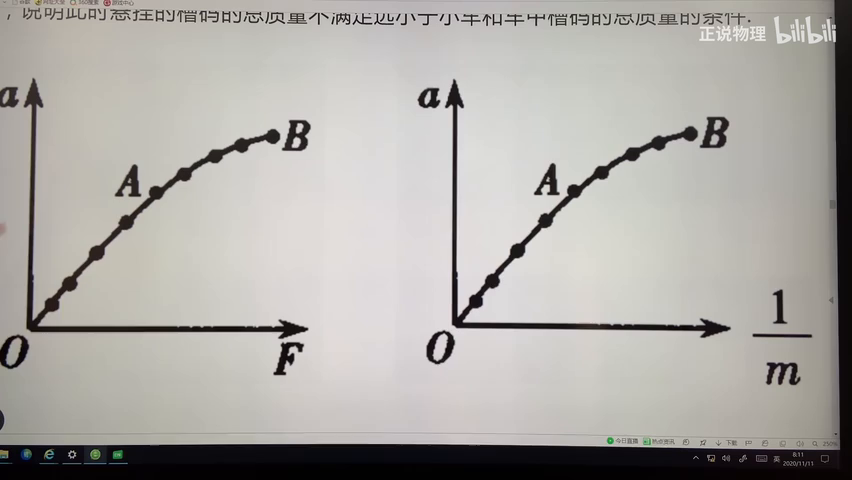

## 七、实验注意事项（约26:00—27:40）

老师按课件归纳了以下要求：

1. **小车靠近打点计时器，先接通电源，后释放小车。**
2. **平衡摩擦力时不悬挂小桶。** 小车要连着纸带，且打点计时器应接通电源。用手轻轻给小车一个初速度，根据纸带上点的间距是否均匀来判断。
3. **改变小车质量时，始终保证悬挂物的质量远小于小车的质量。** 这一页课件以“砂和小桶”为例说明。
4. **作图时，直线应通过尽可能多的点。** 不在直线上的点应尽可能对称地分布在直线两侧；个别偏离较远的点可以舍去。

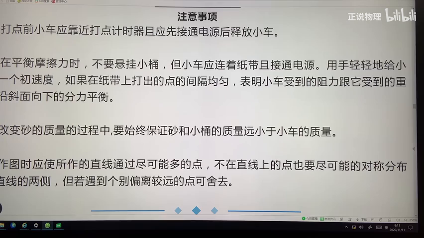

## 八、实验方案二：通过位移之比测量加速度之比（约27:40—33:37）

### 1. 两车同时开始、同时停止

老师介绍第二种方案，仍然用悬挂物牵引小车，但通过比较位移来比较加速度。

两辆小车的前端分别通过细线、定滑轮连接小盘，盘中可以放不同的重物。木板一端垫高，参照方案一补偿阻力。

两辆小车后端也各系一条细线，用同一个黑板擦同时压住两条细线：抬起黑板擦，两车同时开始运动；按下黑板擦，两车同时停止。

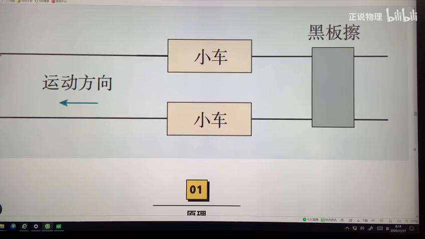

用刻度尺测出两辆小车的位移 $x_1$、$x_2$。老师强调，两车的运动时间相同，而且从静止开始做匀加速直线运动。

由

$$
s=\frac{1}{2}at^2
$$

可用位移之比得到加速度之比：

$$
a_1:a_2=x_1:x_2
$$

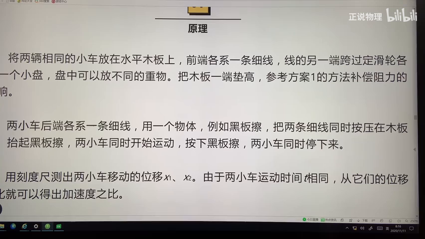

### 2. 对比演示一：质量相等，拉力之比为1∶2

实验条件为：

$$
M_1=M_2,\qquad F_1:F_2=1:2
$$

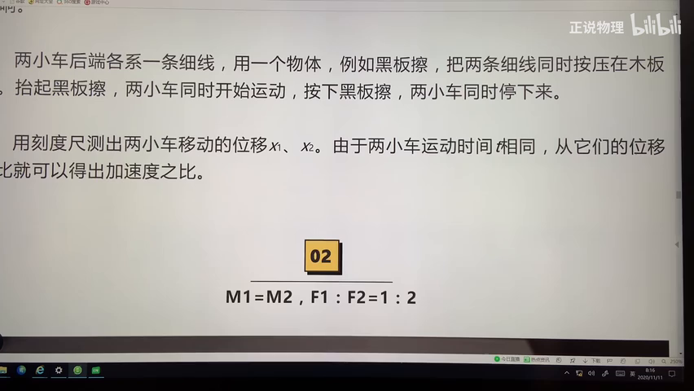

两车同时运动、同时停止后，比较位移。由位移之比得到：

$$
a_1:a_2=1:2
$$

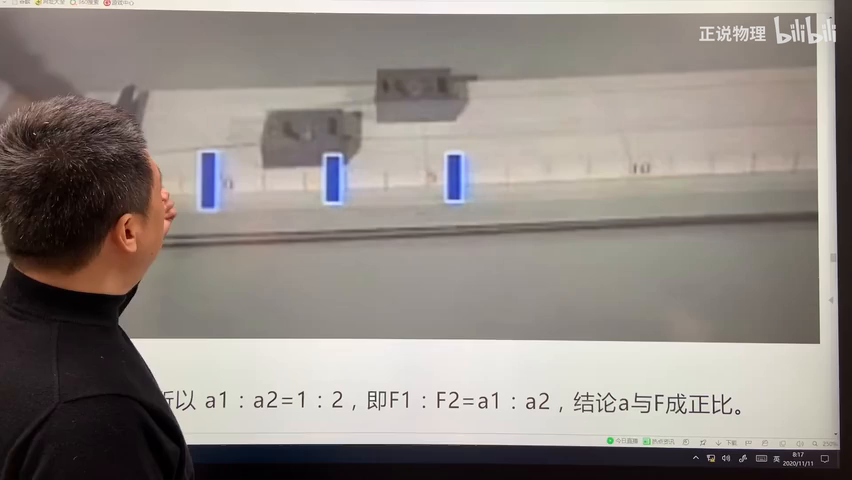

即

$$
F_1:F_2=a_1:a_2
$$

老师据此说明：在质量相等的条件下，加速度与拉力成正比。老师也提醒，不能只做这一次就作结论，还要改变条件再做，检验比例关系。

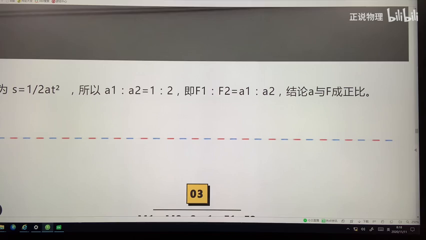

### 3. 对比演示二：拉力相等，质量之比为2∶1

实验条件为：

$$
M_1:M_2=2:1,\qquad F_1=F_2
$$

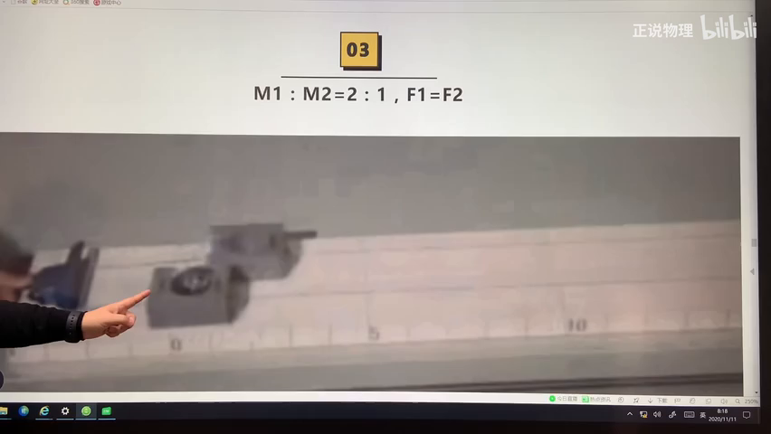

再次比较相同时间内的位移，得到：

$$
a_1:a_2=1:2
$$

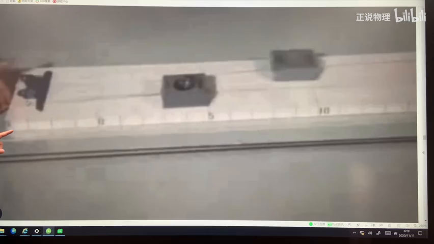

即

$$
M_1:M_2=a_2:a_1
$$

老师据此说明：在拉力相等的条件下，加速度与质量成反比。

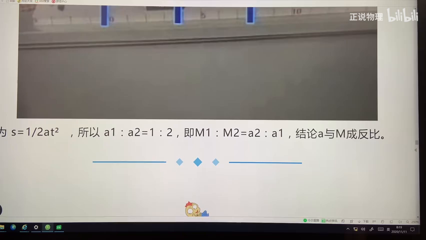

结尾，老师让同学们回看本节实验的思维、严谨性和技巧，体会怎样控制变量、怎样设计实验，并回顾了用质量倒数作图、用位移比比较加速度的做法。

> 本集没有单独的习题题目页，末段为以上两组对比实验；实验条件、演示画面和结论均已截图收录。
